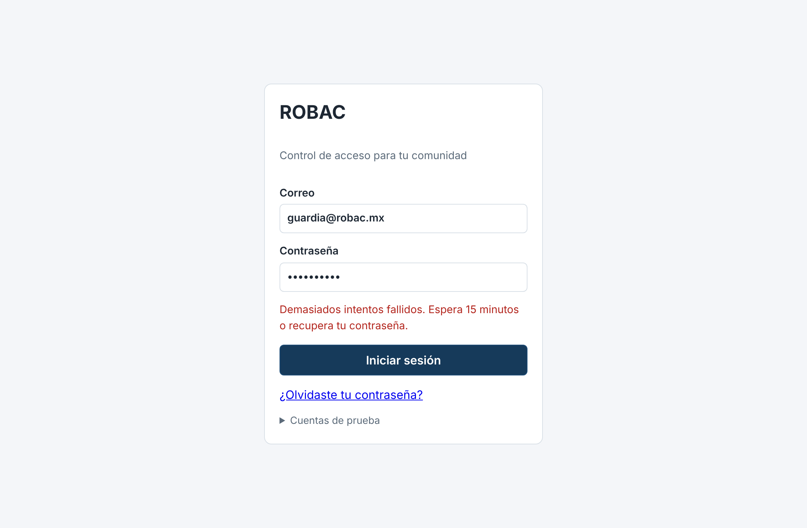
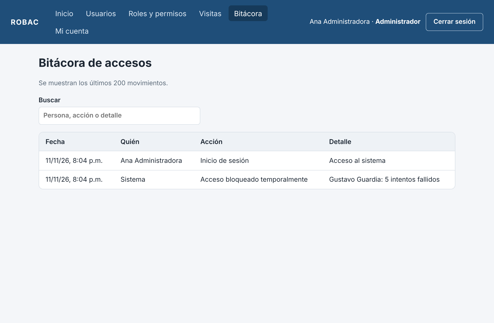

## Resumen

ROBAC es un sistema de control de acceso basado en roles (RBAC) para comunidades privadas, cotos y residenciales, desarrollado en React y Node por Jorge Arturo Alvarado Díaz de León dentro de un equipo Scrum de 3 integrantes (Product Owner: Compañero B; Scrum Master: Compañero C).

El reporte final (actividad 4) dejó tres pendientes: enviar el código de recuperación por correo, limitar los intentos fallidos de inicio de sesión y publicar el sistema. En la reunión de revisión del 11 de noviembre de 2026 el equipo los convirtió en historias de usuario y los planeó como Sprint 5. Ese mismo día se terminaron 3 historias nuevas, las pruebas automáticas pasaron de 52 a 66 y todo se subió a GitHub con un commit por historia. La publicación en un servidor real queda como única historia pendiente (HU20).

## 1. Planeación de la reunión de revisión

| Dato | Detalle |
| --- | --- |
| Reunión | Revisión de mejoras y planeación del Sprint 5 |
| Fecha | Miércoles 11 de noviembre de 2026, 60 minutos |
| Participantes | Jorge Alvarado (Desarrollador), Compañero B (Product Owner), Compañero C (Scrum Master) |
| Insumos | Reporte final (actividad 4, sección 5), observaciones del asesor, backlog y repositorio de GitHub |
| Siguiente reunión | Viernes 13 de noviembre de 2026: cierre del Sprint 5 y decisión sobre la publicación (HU20) |

### Agenda

| # | Punto | Responsable | Tiempo |
| --- | --- | --- | --- |
| 1 | Repasar las observaciones del reporte final y del asesor | Scrum Master | 10 min |
| 2 | Convertir las mejoras en historias y priorizar el backlog | Product Owner | 15 min |
| 3 | Planear el Sprint 5: qué entra y cómo se prueba | Equipo | 15 min |
| 4 | Retrospectiva del proyecto de cada integrante | Cada integrante | 15 min |
| 5 | Acuerdos y fecha de la siguiente reunión | Scrum Master | 5 min |

### Acuerdos

1. El Sprint 5 incluye HU17 (intentos fallidos), HU18 (correo) y HU19 (preparar la publicación).
2. La publicación real (HU20) se pasa al Sprint 6 porque requiere contratar el servicio de publicación y una cuenta de correo del equipo, decisión que corresponde al Product Owner.
3. Cada cambio se sube a GitHub con un mensaje que nombre la historia, en lugar de «Add files via upload».
4. Ninguna historia se da por terminada sin pruebas automáticas que la cubran.

## 2. Mejoras sugeridas

| # | Mejora | Origen | Prioridad | Historia | Estado |
| --- | --- | --- | --- | --- | --- |
| 1 | Limitar los intentos fallidos de inicio de sesión | Reporte final, sección 5 | Alta | HU17 | Terminada |
| 2 | Enviar el código de recuperación por correo | Reporte final, sección 5 | Alta | HU18 | Terminada |
| 3 | Preparar el sistema para publicarse | Reporte final, sección 5 | Media | HU19 | Terminada |
| 4 | Publicar el sistema en un servidor | Reporte final, sección 5 | Media | HU20 | Pendiente (Sprint 6) |
| 5 | Mensajes de commit descriptivos en GitHub | Retrospectiva | Media | — | Terminada |
| 6 | No subir dependencias, base de datos ni claves al repositorio | Retrospectiva | Media | HU19 | Terminada (`.gitignore`) |
| 7 | Cambiar las contraseñas de las cuentas de prueba antes de publicar | Retrospectiva | Alta | HU20 | Pendiente |

### Recomendaciones del asesor

| Recomendación | Cómo se atendió |
| --- | --- |
| *[Por completar: recomendación del asesor]* | *[Por completar: mejora o historia que la atiende]* |
| *[Por completar]* | *[Por completar]* |

## 3. Bitácora de modificaciones

### Backlog actualizado

| HU | Historia | Sprint | Estado |
| --- | --- | --- | --- |
| HU1 a HU5 | Acceso, roles, rutas protegidas, menú por rol, pantalla de inicio | 1 | Terminadas |
| HU6 a HU10 | Usuarios, matriz de permisos, visitas, entrada y salida, bitácora | 2 | Terminadas |
| HU12 a HU15 | Cifrado, edición de usuarios, Mi cuenta, restablecimiento | 3 | Terminadas |
| HU11 y HU16 | Servidor con base de datos, recuperación con código | 4 | Terminadas |
| HU17 | Bloquear el inicio de sesión tras 5 intentos fallidos | 5 | Terminada |
| HU18 | Enviar el código de recuperación por correo (SMTP) | 5 | Terminada |
| HU19 | Preparar la publicación: variables de entorno, ruta de salud y `.gitignore` | 5 | Terminada |
| HU20 | Publicar el sistema en un servidor con correo real | 6 | Pendiente |

El backlog pasó de 16 a 20 historias: 19 terminadas y 1 pendiente. La versión completa está en `docs/BACKLOG.md`.

### Cambios en GitHub

| Fecha | Commit | Historia | Qué cambió |
| --- | --- | --- | --- |
| 11/11/2026 | 9b83275 | HU18 | Nuevo `server/correo.js`: envía el código por SMTP con STARTTLS o TLS. Si no hay servidor de correo configurado, el código sigue saliendo en la consola |
| 11/11/2026 | d6c1173 | HU17, HU19 | Tabla `intentos_login`, bloqueo de 15 minutos tras 5 fallos, registro en la bitácora, ruta `/api/salud` y 14 pruebas nuevas |
| 11/11/2026 | 3ca727a | HU19 | `.gitignore`, `.env.example` y el README con el Sprint 5, la configuración del correo y los pasos para publicar |
| 11/11/2026 | (este documento) | — | Bitácora de la actividad 5, `docs/BACKLOG.md` y capturas en `docs/img` |

### Ajustes y decisiones técnicas

| Ajuste | Qué se hizo | Motivo |
| --- | --- | --- |
| Bloqueo por correo | Los fallos se cuentan por correo, exista o no la cuenta | Que el sistema no revele quién está registrado. Desventaja aceptada: alguien podría bloquear a otra persona 15 minutos; por eso recuperar la contraseña quita el bloqueo |
| Contraseña correcta también bloqueada | Durante el bloqueo se responde 429 aunque la contraseña sea la buena | Si no, el bloqueo no detendría a quien prueba contraseñas |
| Bloqueo en la bitácora | Se anota «Acceso bloqueado temporalmente» con el nombre de la cuenta | Que el administrador y el guardia vean los intentos sospechosos |
| SMTP sin dependencias | El envío usa los módulos `net` y `tls` de Node | No agregar librerías externas; el protocolo necesario es pequeño y se prueba con un servidor de correo falso |
| Correo siempre cifrado | La contraseña del correo nunca se envía por una conexión sin cifrar | Proteger la cuenta de correo del equipo |
| Consola como respaldo | Sin `SMTP_HOST`, el código se escribe en la consola | Poder desarrollar y probar sin un servidor de correo |
| Publicación preparada, no realizada | Se dejó todo listo en variables de entorno, pero no se publicó | Publicar requiere cuentas y costos que decide el Product Owner |

## 4. Evidencia

Capturas tomadas el 11 de noviembre de 2026 con el sistema compilado y el servidor real en ejecución.

{width=70%}

{width=90%}

Al arrancar, el servidor indica a dónde van los códigos de recuperación:

`Códigos de recuperación: consola` (sin SMTP) o `Códigos de recuperación: SMTP smtp.ejemplo.mx:587` (con SMTP).

### Pruebas automáticas

La suite se ejecutó tres veces seguidas y las tres dieron `Test Files 6 passed (6) · Tests 66 passed (66)`.

| Archivo | Pruebas | Qué cubre |
| --- | --- | --- |
| `server/api.test.js` | 32 | API de los Sprint 1 a 4 |
| `server/sprint5.test.js` | 13 | Bloqueo por intentos fallidos, ruta de salud y envío por SMTP (incluido STARTTLS) |
| `src/test/` (4 archivos) | 21 | Pantallas de React contra el servidor real, incluido el aviso de bloqueo |

## 5. Retrospectiva de los proyectos del equipo

### Proyecto de Jorge Alvarado: ROBAC

| Qué funcionó | Qué no funcionó | Acción para el siguiente Sprint |
| --- | --- | --- |
| Dividir las historias que dependían de otra evitó arrastrar trabajo sin terminar | El servidor se pospuso hasta el Sprint 4 y hubo que rehacer el cifrado que se había hecho en el navegador | Definir la arquitectura (servidor y base de datos) en el primer Sprint |
| Las pruebas crecieron de 7 a 66 y detectaron errores antes de entregar | Los cambios se subieron con «Add files via upload», sin decir qué historia cubrían | Un commit por historia con un mensaje descriptivo (aplicado en el Sprint 5) |
| Validar los permisos en el servidor cerró la forma de saltarse las reglas desde el navegador | No se estimaron puntos de historia, así que las gráficas solo cuentan historias | Estimar en puntos desde el Sprint 6 |
| El README se actualizó en cada Sprint y sirve como guía para ejecutar el sistema | En el Sprint 4 una prueba falló de forma intermitente | Ejecutar la suite tres veces antes de cada entrega (aplicado en el Sprint 5) |

### Proyecto de Compañero B

| Qué funcionó | Qué no funcionó | Acción para el siguiente Sprint |
| --- | --- | --- |
| *[Por completar por Compañero B]* | *[Por completar]* | *[Por completar]* |

### Proyecto de Compañero C

| Qué funcionó | Qué no funcionó | Acción para el siguiente Sprint |
| --- | --- | --- |
| *[Por completar por Compañero C]* | *[Por completar]* | *[Por completar]* |

## 6. Reporte de roles

| Integrante | Rol | Qué hizo en esta actividad |
| --- | --- | --- |
| Jorge Alvarado | Desarrollador | Implementó HU17, HU18 y HU19 con sus 14 pruebas; ejecutó la suite completa; tomó las capturas; subió los cambios a GitHub con un commit por historia; redactó esta bitácora y actualizó el backlog |
| Compañero B | Product Owner | Convirtió las mejoras sugeridas en las historias HU17 a HU20, las priorizó, aceptó las tres historias del Sprint 5 y decidió posponer la publicación real (HU20) |
| Compañero C | Scrum Master | Convocó y moderó la reunión, presentó las observaciones del reporte final y del asesor, condujo la retrospectiva y registró los acuerdos |

## 7. Repositorio en GitHub

Repositorio del Proyecto 2: <https://github.com/Jorge1x10/PROYECTO-II>

Los cambios descritos en esta bitácora están en la carpeta `robac/` y corresponden a los commits 9b83275, d6c1173 y 3ca727a:

- `robac/server/correo.js`: envío del código por correo (HU18).
- `robac/server/app.js` y `robac/server/db.js`: bloqueo por intentos fallidos y ruta de salud (HU17 y HU19).
- `robac/server/sprint5.test.js` y `robac/src/test/sprint5.test.jsx`: 14 pruebas nuevas.
- `robac/README.md`, `robac/.env.example` y `.gitignore`: configuración del correo y pasos para publicar.
- `docs/BACKLOG.md` y este documento: backlog y bitácora de la actividad 5.

## Conclusión

La reunión de revisión convirtió los tres pendientes del reporte final en historias de usuario. Dos se terminaron por completo (intentos fallidos y correo) y la tercera se dividió: la preparación quedó lista y la publicación real pasa al Sprint 6. ROBAC suma 19 de 20 historias terminadas y 66 pruebas automáticas que pasan. Lo que falta para usarlo con datos reales es publicarlo con una cuenta de correo del equipo y cambiar las contraseñas de las cuentas de prueba.
