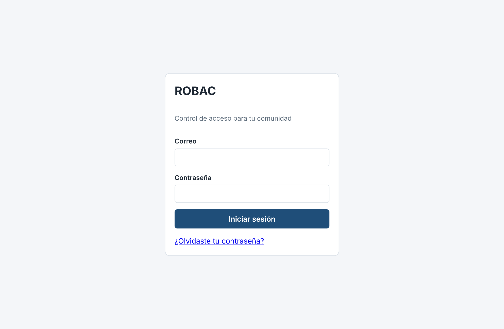
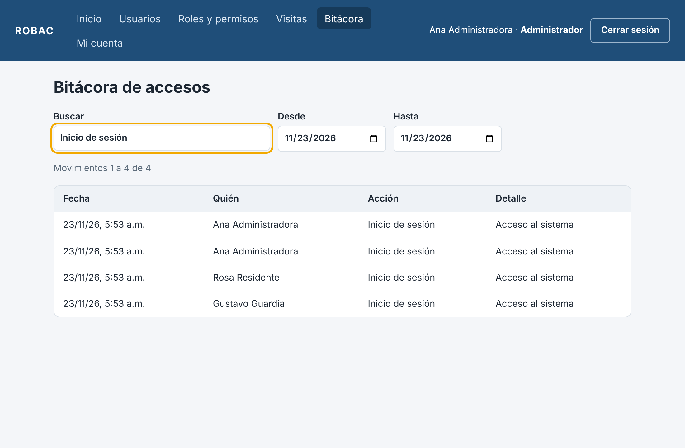

| Dato | Detalle |
| --- | --- |
| Equipo | Jorge Alvarado (Desarrollador), Compañero B (Product Owner) y Compañero C (Scrum Master) |
| Proyecto | ROBAC: control de acceso basado en roles para comunidades privadas (React, Node y SQLite) |
| Liga de GitHub | <https://github.com/Jorge1x10/PROYECTO-II/tree/claude/busy-carson-vq447d> |
| Resultado | 6 de las 7 modificaciones propuestas en la actividad 6 terminadas; las pruebas automáticas pasan de 66 a 79 |

## 1. Reunión de equipo

| Dato | Detalle |
| --- | --- |
| Reunión | R2 · Seguimiento de modificaciones (calendario de la actividad 6) |
| Fecha | Viernes 27 de noviembre de 2026, 19:00 a 20:00, por Google Meet |
| Objetivo | Presentar las modificaciones hechas a ROBAC, aceptarlas y decidir lo pendiente (HU20 y HU21) |
| Insumos | Propuestas HU21 a HU27, recomendaciones del asesor, backlog y repositorio de GitHub |
| Avance previo | Las modificaciones se hicieron y se subieron a GitHub el 23 de noviembre, antes de la reunión |

### Agenda

| Tiempo | Punto | Responsable |
| --- | --- | --- |
| 5 min | Recomendaciones del asesor y cómo se atendieron | Compañero C (SM) |
| 10 min | Demostración de las modificaciones en el sistema | Jorge Alvarado (Dev) |
| 5 min | Aceptar o rechazar cada historia y decidir HU20 y HU21 | Compañero B (PO) |

## 2. Recomendaciones del asesor

| Recomendación | Cómo se atendió |
| --- | --- |
| *[Por completar: recomendación del asesor]* | *[Por completar: historia o cambio que la atiende]* |
| *[Por completar]* | *[Por completar]* |

## 3. Bitácora de modificaciones

| HU | Modificación | Qué se hizo | Commit | Estado |
| ------ | ------------ | ---------------------------- | -------- | ----------- |
| HU22 | Primer administrador sin cuentas de prueba | Con `ROBAC_ADMIN_CORREO` y `ROBAC_ADMIN_CLAVE`, la base nueva solo tiene ese administrador. En producción el servidor no arranca con las cuentas de prueba, y la pantalla de inicio las oculta si no existen | `4fa1830` | Terminada |
| HU25 | Respaldos de la base de datos | Respaldo al arrancar y cada 24 horas; se conservan los últimos 7. Respaldo manual con `npm run respaldo` | `a0381fd` | Terminada |
| HU27 | Bitácora con filtros | Búsqueda en todo el historial, filtros Desde y Hasta, y páginas de 50 movimientos | `c7c5c14` | Terminada |
| HU23 | Pruebas en GitHub Actions | El lint, las pruebas y la compilación corren solos en cada cambio subido | `8da5e40` | Terminada |
| HU24 | Repositorio limpio | Se quitó de la raíz la copia de los Sprint 1 a 3; sigue en el historial (commit `384a807`) | `40a83c4` | Terminada |
| HU26 | Manual de usuario por rol | `docs/MANUAL_USUARIO.md`: entrar, recuperar la contraseña y las tareas del residente, el guardia y el administrador | `68e7add` | Terminada |
| HU21 | Unir la última versión a `main` | Todos los cambios están listos en la rama; falta aprobar el pull request | — | Pendiente (decide el PO en R2) |
| HU20 | Publicar el sistema | Ya está preparado (administrador, respaldos y correo por variables de entorno); falta la cuenta de publicación y la de correo | — | Pendiente (Sprint 7) |

### Ajustes y decisiones

| Ajuste | Motivo |
| --- | --- |
| En producción el servidor revisa la configuración antes de crear la base | En la primera versión alcanzaba a crear la base con las cuentas de prueba antes de detenerse, y el siguiente arranque, ya con administrador, también fallaba |
| La clave del primer administrador pide 8 caracteres o más, no 6 | Es la cuenta con más permisos del sistema |
| La búsqueda de la bitácora se hace en el servidor | Antes solo buscaba entre los 200 movimientos cargados; ahora busca en todo el historial |
| Se corrigió `.env.example` | Decía que bastaba copiarlo a `.env`, pero el servidor no lo lee solo; se arranca con `node --env-file=.env server/index.js` |
| Un commit por historia | Acuerdo de la retrospectiva de la actividad 5 |

## 4. Back log

| HU | Historia de usuario | Sprint | Estado |
| --- | --- | --- | --- |
| HU1 a HU5 | Inicio de sesión, roles y permisos, rutas protegidas, menú por rol, pantalla de inicio | 1 | Terminadas |
| HU6 a HU10 | Usuarios, matriz de permisos, autorizar visitas, entrada y salida, bitácora | 2 | Terminadas |
| HU12 a HU15 | Contraseñas cifradas, edición de usuarios, Mi cuenta, restablecimiento | 3 | Terminadas |
| HU11 y HU16 | Servidor con base de datos, recuperación de contraseña con código | 4 | Terminadas |
| HU17 a HU19 | Bloqueo por intentos fallidos, código por correo, preparación para publicar | 5 | Terminadas |
| HU22 a HU27 | Primer administrador, GitHub Actions, repositorio limpio, respaldos, manual, bitácora con filtros | 6 | Terminadas |
| HU21 | Unir la última versión a `main` | 6 | Pendiente |
| HU20 | Publicar el sistema | 7 | Pendiente |

Avance: 25 de 27 historias terminadas. El detalle de cada historia está en `docs/BACKLOG.md`.

| Sprint | 1 y 2 | 3 | 4 | 5 | 6 |
| --- | --- | --- | --- | --- | --- |
| Pruebas automáticas que pasan | 7 | 15 | 52 | 66 | 79 |

## 5. Evidencia

{width=60%}

{width=85%}

Con el servidor en producción y sin administrador, el arranque se detiene con el mensaje: `No se puede iniciar ROBAC en producción sin administrador. Define ROBAC_ADMIN_CORREO y ROBAC_ADMIN_CLAVE para crear al primer administrador.`

Las 79 pruebas pasaron en tres corridas seguidas (`Test Files 8 passed (8) · Tests 79 passed (79)`), y el lint y la compilación terminaron sin errores. En GitHub, la primera ejecución de «Pruebas de ROBAC» terminó con éxito: <https://github.com/Jorge1x10/PROYECTO-II/actions/runs/45120834069>

## 6. Reporte de roles

| Integrante | Rol | Qué hizo en la actividad |
| --- | --- | --- |
| Jorge Alvarado | Desarrollador de ROBAC | Implementó HU22 a HU27 con 13 pruebas nuevas, verificó el sistema en modo producción y demostración, subió un commit por historia, actualizó el backlog y redactó esta bitácora |
| Compañero B | Product Owner de ROBAC | Prioriza las modificaciones, acepta o rechaza cada historia en R2 y decide cuándo unir la rama a `main` (HU21) y cuándo publicar (HU20) |
| Compañero C | Scrum Master de ROBAC | Convoca y modera R2, presenta las recomendaciones del asesor y registra los acuerdos en la minuta |

En los proyectos de sus compañeros, Jorge Alvarado es Scrum Master del sistema de Compañero B (escribe la minuta de su bloque) y Product Owner del sistema de Compañero C (prioriza y acepta sus cambios).

## 7. Liga de GitHub

- Última versión: <https://github.com/Jorge1x10/PROYECTO-II/tree/claude/busy-carson-vq447d>
- Cambios de esta actividad: commits `4fa1830` a `32f6ac4` (detalle en la sección 3 y en `docs/BACKLOG.md`)
- Manual de usuario: `docs/MANUAL_USUARIO.md`
